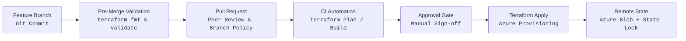

  <!-- Top Animated Banner -->

  

  <!-- Animated Typing Effect -->
  

  <!-- Social & Contact Badges -->
  

    
    
    
    
  

---

### 👨‍💻 Professional Summary

- 🎓 **Education:** Master of Computer Applications (MCA) — 3rd Semester, Galgotias University.
- 💼 **Industry Training & Internship:** DevOps & Cloud Intern at **DevOps Insiders** — practical training in building automated cloud infrastructure and deployment pipelines.
- 🎯 **Primary Focus (0–1 Year Hands-On):** Infrastructure as Code (IaC) with **Terraform**, **Microsoft Azure Cloud**, **CI/CD Pipelines** (Azure DevOps & GitHub Actions), and **Git** version control.
- 🛠️ **Engineering Mindset:** Delivering reproducible, version-controlled cloud infrastructure with remote state management, parameterization, automated quality checks, and cost discipline.

---

### 🛠️ Technical Competencies

#### 🚀 Core Specialization (Hands-On)

  
  
  
  
  
  

#### 🧰 Operating Systems, Scripting & Systems Fundamentals

  
  
  
  
  
  

---

### 📐 Standard Infrastructure & CI/CD Delivery Workflow

---

### 🏗️ Practical Skills & Concepts Breakdown

Based on industry-standard engineering practices taught at DevOps Insiders:

- **Infrastructure as Code (Terraform):**
  - Modular resource structuring and DRY code architecture.
  - Remote state backend configuration using Azure Blob Storage with state lease locking.
  - Dynamic provisioning using Terraform expressions, `for_each`, nested maps, and collections.
  - Reusable parameterization with `variable.tf` and environment-specific `.tfvars`.
- **Microsoft Azure Cloud:**
  - Resource Groups, Virtual Networks (VNets), Subnets, and Network Security Groups (NSGs).
  - Azure Storage Accounts (Blob, Containers, Access Tiers, Lifecycle).
  - Azure App Service, Azure Container Registry (ACR), and Linux Virtual Machines.
  - Role-Based Access Control (RBAC) fundamentals and Least Privilege access principles.
- **CI/CD & Version Control:**
  - Git branching strategies (feature branches, trunk-based delivery, and PR review hygiene).
  - Automated build, test, and deployment workflows using GitHub Actions and Azure DevOps Pipelines.
  - Containerization basics: Dockerfile authoring, image building, and container deployment.
- **Cost & Operational Discipline (FinOps Awareness):**
  - Clean lifecycle management: identifying and destroying unused lab resources to prevent stray cloud billing.

---

### 📂 Hierarchical Projects & Hands-On Repositories

#### 🌟 1. Capstone Project (Academic & DevOps Integration)

| Repository | Tech Stack | Highlights & Architecture |
| :--- | :--- | :--- |
| [**DevOps Pipeline Optimization System**](https://github.com/vishalnik002-git/mca-sem3-devops-pipeline) | `Python (Flask)` `Docker` `GitHub Actions` `Terraform` `Azure App Service` `ACR` | • **MCA 3rd Semester Major Academic Project**. • End-to-end automated software delivery pipeline. • Triggered via GitHub Actions on push to `main` branch. • Packages Flask web app into a Docker container and pushes to Azure Container Registry (ACR). • Provisions required cloud infrastructure (Service Plan, Web App) via Terraform. • Continuous Deployment to Azure Linux Web App. |

#### ☁️ 2. Infrastructure as Code (Terraform & Azure Hands-On)

| Repository | Focus Area | Concepts & Implementation |
| :--- | :--- | :--- |
| [**Terraform Remote State Backend**](https://github.com/vishalnik002-git/terraform-remote-state-backend) | `Azure Blob` `Remote State` `Locking` | • Production state management configuring Azure Blob Storage as a remote backend. • Prevents concurrent state corruption using native Azure Blob lease locking. |
| [**Terraform Azure RG & Storage Automation**](https://github.com/vishalnik002-git/terraform-azure-rg-storage-automation) | `Nested Maps` `for_each` `Automation` | • Dynamic multi-resource provisioning across Azure Resource Groups and Storage Accounts. • Utilizes nested maps and `for_each` loops to eliminate redundant code blocks. |
| [**Terraform Loops & Collections**](https://github.com/vishalnik002-git/terraform-loops-collections) | `Data Structures` `Collections` `HCL` | • Hands-on implementation of Terraform collection types (`list`, `set`, `map`). • Iteration logic and dynamic attribute assignment across Azure cloud components. |
| [**Terraform Variables & Storage Account**](https://github.com/vishalnik002-git/terraform-variables-storage-account) | `Variables` `Parameterization` `DRY` | • Parameterized infrastructure design separating variables (`variable.tf`), values (`terraform.tfvars`), and resource definitions (`main.tf`). |
| [**Terraform Foundational Azure Labs**](https://github.com/vishalnik002-git/terraform-hardcoded-rg) | `AzureRM Provider` `Resource Lifecycle` | • Foundational labs provisioning Azure Resource Groups and Storage Accounts. • Managing implicit resource dependencies and Terraform state lifecycle (`init`, `plan`, `apply`, `destroy`). |

#### 🌐 3. Portfolio & Web

| Repository | Tech Stack | Highlights |
| :--- | :--- | :--- |
| [**DevOps Portfolio Website**](https://github.com/vishalnik002-git/vishal-devops-portfolio) | `HTML` `CSS` `JavaScript` | • Responsive web portfolio highlighting DevOps projects, skills, and technical profile. |

---

### 📊 GitHub Activity & Analytics

  <table border="0">
    <tr>
      <td>
        
      </td>
      <td>
        
      </td>
    </tr>
    <tr>
      <td colspan="2" align="center">
        
      </td>
    </tr>
  </table>

---

  

