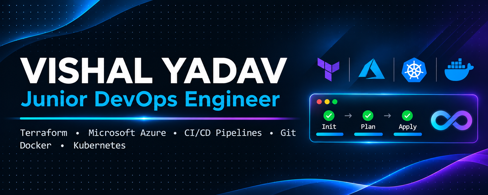

<div align="center">

  <!-- Top Banner Image -->
  <p align="center">
    
  </p>

  <!-- Animated Typing Subtitle -->
  <a href="https://github.com/vishalnik002-git">
    
  </a>

  <!-- Social & Contact Badges -->
  <p align="center">
    <a href="https://github.com/vishalnik002-git">
      
    </a>
    <a href="https://www.linkedin.com/in/vishal-yadav002">
      
    </a>
    <a href="mailto:Vishalnik002@gmail.com">
      
    </a>
    
  </p>

</div>

---

### 👨‍💻 About Me

- 🎓 **Education:**
  - **Master of Computer Applications (MCA)** — Galgotias University (2025 – 2027)
  - **Bachelor of Computer Applications (BCA)** — Computer Science Foundation
- 💼 **Industry Training & Experience:** DevOps & Cloud Intern at **DevOps Insiders** — practical hands-on training provisioning cloud infrastructure and configuring automated deployment pipelines.
- 🎯 **Core Focus:**
  - **Infrastructure as Code (IaC):** Terraform (AzureRM, Modules, Remote State Locking)
  - **Cloud Platform:** Microsoft Azure (VNets, Subnets, NSG, Storage, App Service, ACR)
  - **CI/CD Automation:** Azure DevOps Pipelines & GitHub Actions
  - **Version Control:** Git & GitHub (Branching workflows, PR reviews)
- 💡 **Engineering Approach:** Writing clean, reusable Terraform code (DRY principle), automating cloud resources to eliminate manual errors, and maintaining resource discipline to prevent unnecessary cloud costs.

---

### 🛠️ Technical Competencies

#### ☁️ Cloud Platform
<p align="left">
  
  
  
  
  
</p>

#### 🏗️ Infrastructure as Code (IaC)
<p align="left">
  
  
  
  
</p>

#### 🚀 CI/CD & Delivery Automation
<p align="left">
  
  
</p>

#### 🌿 Version Control & Collaboration
<p align="left">
  
  
</p>

#### 💻 Operating Systems & Scripting
<p align="left">
  
  
  
  
</p>

#### 📦 Containers & Systems (Foundations)
<p align="left">
  
  
</p>

---

### 🔄 CI/CD & Infrastructure Delivery Workflow

```text
🌿 Feature Branch (Git) ➔ 🔍 Syntax Validation (fmt & validate) ➔ 🤝 Pull Request (Review) 
   ➔ 📋 CI Automation (Terraform Plan) ➔ 🚀 CD Deployment (Azure Apply) ➔ 🔒 State Locking (Azure Blob)
```

---

### 📂 Hands-On Projects & Practical Repositories

#### 🌟 1. Major Academic Project (MCA 3rd Semester)

| Repository | Tech Stack | Project Summary & Architecture |
| :--- | :--- | :--- |
| [**DevOps Pipeline Optimization System**](https://github.com/vishalnik002-git/mca-sem3-devops-pipeline) | `Python (Flask)` `Docker` `GitHub Actions` `Terraform` `Azure App Service` `ACR` | • **MCA 3rd Semester Major Academic Project** at Galgotias University.<br/>• Automated software delivery pipeline triggered on Git push.<br/>• Builds and packages Flask web application into Docker container images.<br/>• Automatically pushes images to **Azure Container Registry (ACR)**.<br/>• Provisions cloud resources (App Service Plan, Linux Web App, ACR) via **Terraform**.<br/>• Deploys container to live **Azure Linux Web App**. |

#### ☁️ 2. Infrastructure as Code (Terraform & Microsoft Azure)

| Repository | Focus Area | Concepts & Implementation |
| :--- | :--- | :--- |
| [**Terraform Remote State Backend**](https://github.com/vishalnik002-git/terraform-remote-state-backend) | `Azure Blob` `Remote State` `State Locking` | • Configured remote state storage using Azure Blob Storage.<br/>• Implemented native Azure Blob lease locking to prevent state corruption during concurrent runs. |
| [**Terraform Azure RG & Storage Automation**](https://github.com/vishalnik002-git/terraform-azure-rg-storage-automation) | `Nested Maps` `for_each` `Multi-Region` | • Automated provisioning of Resource Groups and Storage Accounts across multiple regions.<br/>• Used nested maps and `for_each` loops to eliminate redundant code blocks. |
| [**Terraform Loops & Collections**](https://github.com/vishalnik002-git/terraform-loops-collections) | `Lists` `Sets` `Maps` `for_each` | • Implemented Terraform collection data types (`list`, `set`, `map`).<br/>• Applied type conversion (`toset`) and dynamic attribute mapping across resources. |
| [**Terraform Variables & Modular Design**](https://github.com/vishalnik002-git/terraform-variables-storage-account) | `variable.tf` `terraform.tfvars` `DRY` | • Parameterized infrastructure separating variable definitions, environment values, and resource blocks.<br/>• Enforced strict type constraints and clean code architecture. |
| [**Terraform Foundational Azure Labs**](https://github.com/vishalnik002-git/terraform-hardcoded-rg) | `AzureRM Provider` `Resource Lifecycle` | • Hands-on labs provisioning Azure Resource Groups and Storage Accounts.<br/>• Learned resource arguments, implicit dependencies, state files, and resource destruction. |

#### 🌐 3. Web Portfolio

| Repository | Tech Stack | Highlights |
| :--- | :--- | :--- |
| [**DevOps Portfolio Website**](https://github.com/vishalnik002-git/vishal-devops-portfolio) | `HTML` `CSS` `JavaScript` | • Responsive personal portfolio website showcasing DevOps projects, technical skills, and background. |

---

### 📊 GitHub Activity & Analytics

<div align="center">
  <table border="0">
    <tr>
      <td>
        
      </td>
      <td>
        
      </td>
    </tr>
    <tr>
      <td colspan="2" align="center">
        
      </td>
    </tr>
  </table>
</div>

---

<div align="center">
  
</div>
