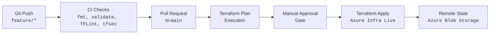

  <!-- Header Banner -->
  

  <!-- Animated Typing Subtitle -->
  

  

    
    
    
  

---

### 👨‍💻 About Me

- 🎓 **Education:** Master of Computer Applications (MCA) at **Galgotias University** with an **8.0+ CGPA**.
- 🛠️ **Training & Experience:** DevOps & Cloud Trainee at **DevOps Insiders** | Virtual Intern at **AICTE EduSkills**.
- ☁️ **Specialization:** Focus on **Infrastructure as Code (Terraform)**, **Microsoft Azure**, and automated **CI/CD delivery pipelines**.
- 🎯 **Philosophy:** Bridging software delivery and infrastructure with consistent automation, security best practices, and cost-efficient cloud designs.
- ⚡ **Current Focus:** Sharpening automated multi-environment infrastructure provisioning and enterprise-grade pipeline security.

---

### 🛠️ Technical Skills

#### 🚀 Core Skills (Strong Hands-On)

  
  
  
  
  
  

#### 🧰 Basics & Supporting Tools

  
  
  
  
  

---

### 🔄 Production CI/CD Workflow

---

### 📂 Featured Hands-On Projects

| Project | Tech Stack | Architecture & Key Deliverables |
| :--- | :--- | :--- |
| **Multi-Environment Azure Infra with Terraform & CI/CD** | `Terraform` `Azure` `Azure DevOps` `Git` `TFLint` `tfsec` | • Built automated, isolated **Dev & Prod** environments (Resource Groups, Virtual Networks, Subnets, NSGs, and Linux VMs running Nginx). • Structured with modular, DRY Terraform architecture with parameter-driven variables. • State persistence configured via **Azure Blob Remote State** with state lease locking. • Automated pre-commit & CI checks: syntax formatting, validation, `TFLint`, security scans with `tfsec`, and mandatory manual gate before apply. |
| **Automated Cloud Cost Cleaner (Azure Automation)** | `Microsoft Azure` `PowerShell Runbooks` `Resource Locks` | • Developed scheduled serverless **PowerShell Runbooks** executing every 2 hours. • Automatically detects and terminates ephemeral/idle lab Resource Groups to eliminate stray compute billing. • Enforces **Azure Delete Locks** on persistent baselines and critical storage resources to guarantee zero accidental deletions. |
| **Containerized Web App Deployment** | `Python Flask` `Docker` `GitHub Actions` `Azure Container Registry` `Azure App Service` | • Packaged a responsive Python Flask dashboard application into multi-stage, hardened Docker images. • Automated unit test execution (`pytest`) directly inside GitHub Actions CI runner on code push. • Triggered automated container pushes to **Azure Container Registry (ACR)** and continuous deployments to **Azure App Service**. |

---

### 📊 GitHub Activity & Analytics

  <table border="0">
    <tr>
      <td>
        
      </td>
      <td>
        
      </td>
    </tr>
    <tr>
      <td colspan="2" align="center">
        
      </td>
    </tr>
  </table>

---

  
<b>✨ <i>"Write Clean IaC • Automate with Pipelines • Keep Cloud Costs Zero"</i> ✨</b>

  

